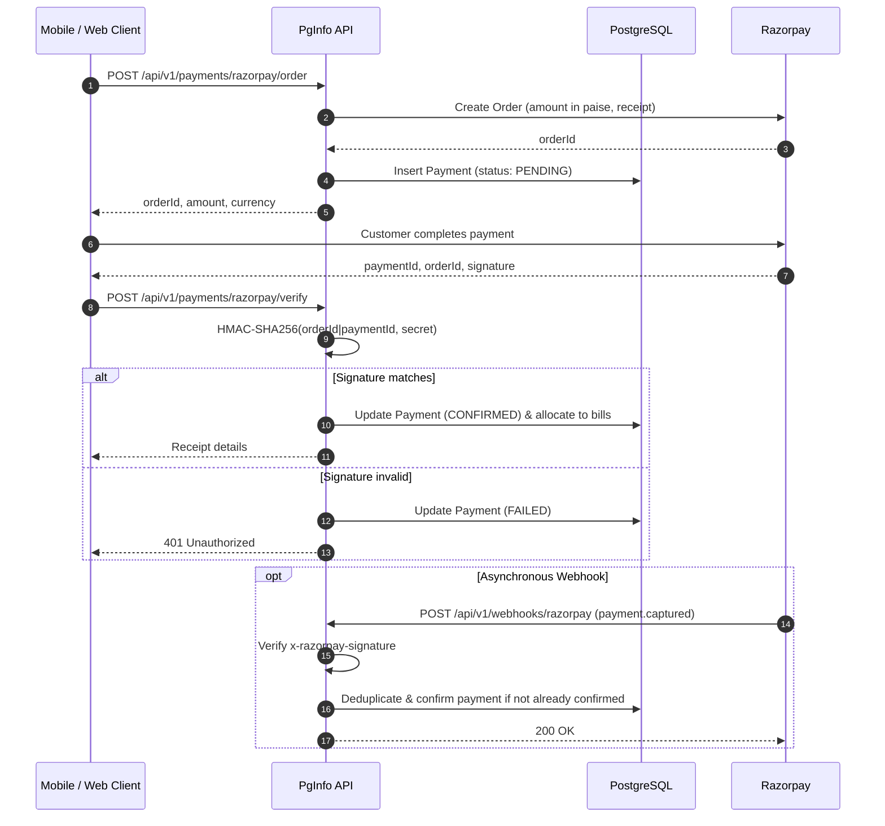

# Payment Reconciliation & Webhook Runbook

## 1. Overview
PgInfo processes rental dues, security deposits, and maintenance charges through two primary rails:
1. **Online Payments**: Automated via Razorpay Orders, Checkout, and Webhooks.
2. **Offline Payments**: Recorded manually by property staff (UPI, Cash, Cheque, Bank Transfer).

---

## 2. Online Payment Lifecycle & Reconciliation



---

## 3. Webhook Handling & Deduplication Rules

1. **Never trust client callbacks alone**: A payment is only marked `CONFIRMED` upon cryptographic verification of the HMAC SHA-256 signature on the server or via authoritative webhook.
2. **Idempotent Webhooks**: If a webhook event for `payment.captured` arrives and the payment has already been marked `CONFIRMED` by the verify endpoint, the system logs the event and returns `200 OK` without double-allocating money to bills.
3. **Webhook Retries**: If the webhook server returns non-200, Razorpay retries over 24 hours. The handler must process repeated delivery without side-effects.

---

## 4. Troubleshooting Delayed or Dropped Payments

If a resident was debited by their bank but their payment is still showing as `PENDING`:

1. Locate the payment in the database using the resident ID or `razorpay_order_id`:
   ```sql
   SELECT id, status, amount, razorpay_order_id, razorpay_payment_id, created_at 
   FROM payments 
   WHERE resident_id = 'RESIDENT_UUID'
   ORDER BY created_at DESC LIMIT 5;
   ```
2. Verify payment status in the Razorpay Dashboard using `razorpay_order_id`.
3. If Razorpay shows the payment as `captured`:
   - Copy `razorpay_payment_id`.
   - Call the internal verification tool or replay the webhook payload to the webhook endpoint.
   - The system will atomically mark the payment `CONFIRMED` and apply payments to the resident's bills FIFO.
